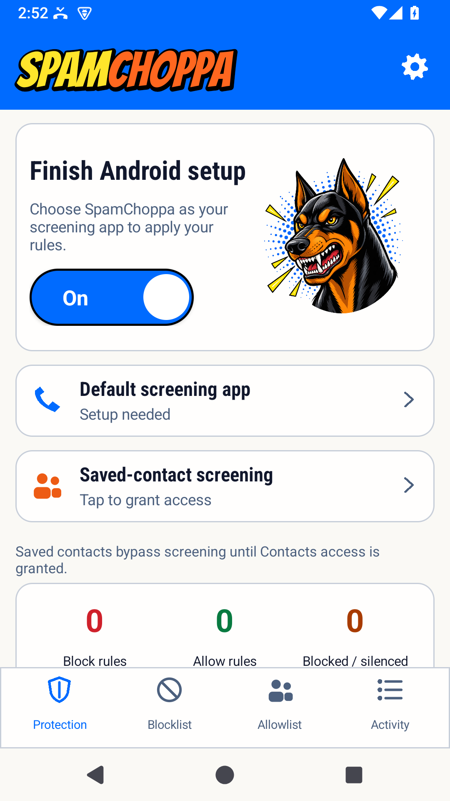
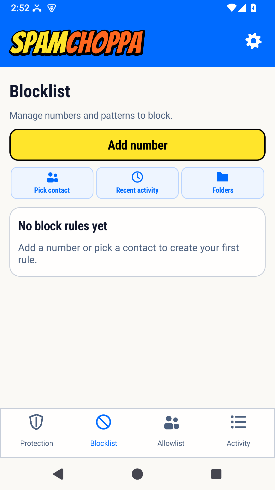
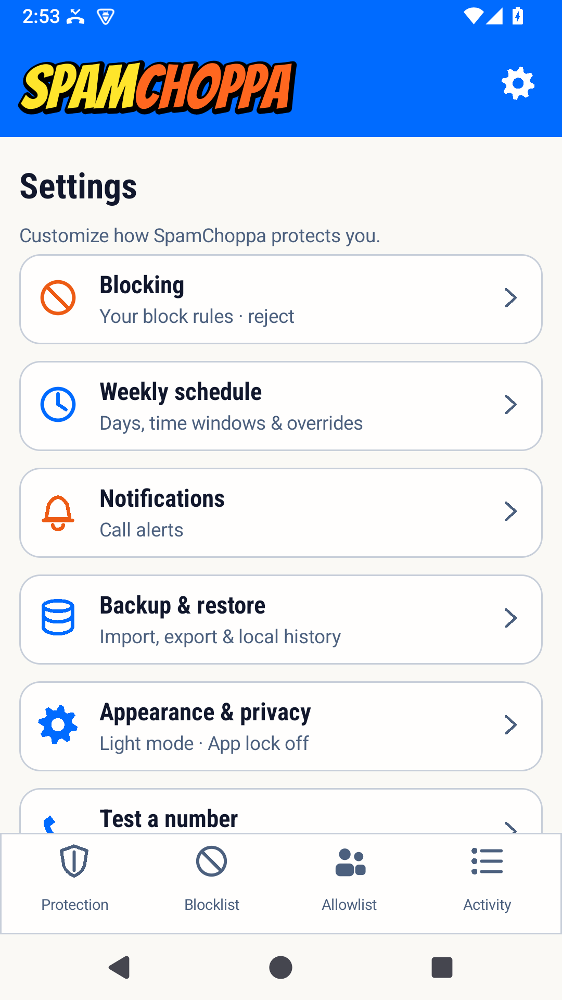
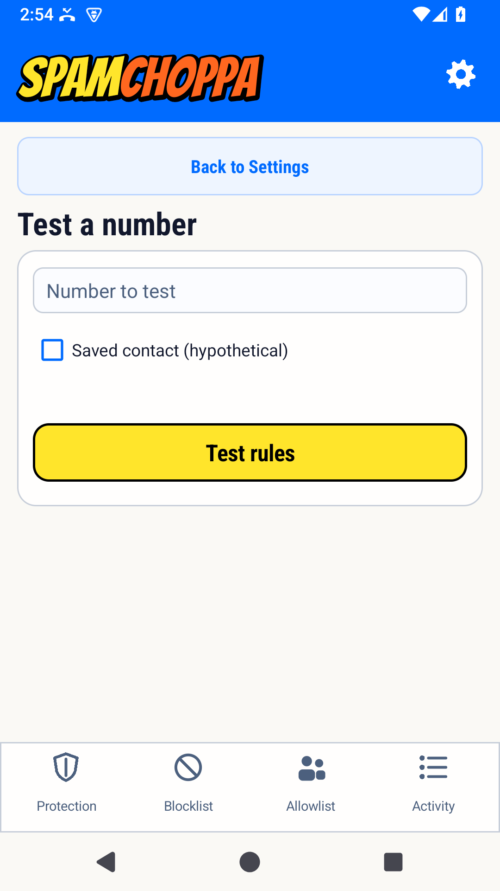

# Screenshots

These actual emulator captures show a clean 0.2.10 installation with no rules configured. The overview is awaiting Android screening setup; it does not demonstrate active call protection. No phone screenshots or personal data are included.

## Protection

## Blocklist

## Settings

## Number tester

## Capture guidance

Use a clean emulator or test device with synthetic numbers and no personal accounts. Inspect the complete image for real numbers, names, call history, notifications, and identifiers. Never commit connected-phone screenshots or unredacted user reports.

Capture the actual app, preserve proportions, and provide descriptive alt text. Keep stable PNG filenames in `docs/assets/screenshots`. Do not edit images to invent controls/results or change a user's security settings for documentation.

[Documentation index](README.md)
